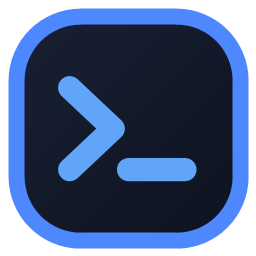

<div align="center">
  
  <h1>DSH Nexus</h1>
  <p><b>Лёгкий Windows-лаунчер в системном трее для DeepSeek Harness, Ollama и локальных веб-инструментов</b></p>
  <p>
    
    
    
    
  </p>
</div>

---

## Зачем нужен DSH Nexus

Веб-интерфейс **DeepSeek Harness** и локальные AI-серверы требуют постоянно открытого окна терминала (`cmd` / PowerShell) — при случайном закрытии консоли сервер останавливается. **DSH Nexus** переносит управление в системный трей Windows:

* **Тихий фоновый запуск:** запускает `pnpm start:web --no-open` и другие CLI-серверы без всплывающих чёрных окон `cmd` и лишних вкладок браузера.
* **Автозагрузка Windows в один клик:** переключатель запуска при входе в систему через ветку реестра `HKCU` прямо из контекстного меню трея (не требует прав администратора и работает в режиме single-file `.exe`).
* **Живой журнал в трее:** левый клик по иконке разворачивает окно консоли с потоком `stdout`/`stderr`, очисткой ANSI-символов, живым поиском по истории и автопрокруткой. Закрытие на крестик сворачивает окно в трей без остановки сервера.
* **Кликабельные ссылки из логов:** автоматически находит все `http://` и `https://` адреса и выводит их в виде кнопок (ЛКМ — открыть в браузере, ПКМ — скопировать в буфер обмена).
* **Внешние JSON-пресеты (`plugins\*.json`):** помимо основного `%AppData%\DshNexus\config.json`, лаунчер автоматически подгружает любые `.json`-файлы из папки `%AppData%\DshNexus\plugins\` и добавляет их в меню трея.
* **Кастомные цветовые схемы:** встроенные темы **Dark**, **Light** и **Midnight**, а также поддержка собственных HEX-палитр в секции `CustomThemes`.
* **Контроль портов и процессов:** освобождает занятый TCP-порт при конфликтах и корректно завершает всё дерево дочерних процессов (`node.exe`, `ollama.exe`) при перезапуске или выходе.

---

## Быстрый старт

### 1. Установка готового релиза
1. Скачайте архив **`DSH-Nexus-win-x64.zip`** со страницы [Releases](https://github.com/Moyawu/dsh-nexus/releases) и распакуйте в постоянную папку (например, `C:\Tools\DSH-Nexus\`).
2. Запустите **`dsh-tray-launcher.exe`** (установка .NET Runtime не требуется — сборка полностью автономна).
3. При первом запуске программа создаст ярлык **`DeepSeek Harness.lnk`** на Рабочем столе, сгенерирует `%AppData%\DshNexus\config.json` и папку `plugins\`, после чего свернётся в системный трей.

### 2. Сборка из исходников (.NET 9 SDK)

```powershell
# Обычная сборка
dotnet build dsh-tray-launcher.csproj -c Release

# Сборка автономного single-file .exe и архива в publish\DSH-Nexus-win-x64.zip
.\scripts\build-release.ps1
```

---

## Конфигурация и плагины (`%AppData%\DshNexus\`)

### Основной конфиг (`config.json`)
Открывается через **ПКМ по иконке в трее → Открыть config.json**. Содержит активный профиль (`ActiveToolId`), выбранную тему (`Theme`), словарь пользовательских тем (`CustomThemes`) и базовый список инструментов (`Tools`):

```json
{
  "ActiveToolId": "dsh",
  "Theme": "Dark",
  "CustomThemes": {
    "Midnight": {
      "WindowBackground": "#090D16",
      "TopBarBackground": "#0F1624",
      "PanelBackground": "#111A2B",
      "ConsoleBackground": "#06090F",
      "BorderColor": "#1E2D4A",
      "PrimaryText": "#E0F2FE",
      "SecondaryText": "#7DD3FC",
      "AccentColor": "#0EA5E9",
      "ButtonBackground": "#132038",
      "ButtonHoverBackground": "#1C3054"
    }
  },
  "Tools": [
    {
      "Id": "dsh",
      "Name": "DeepSeek Harness",
      "RunnerType": "dsh",
      "WorkingDirectory": "S:\\Projects\\dhs\\deepseek-harness",
      "Command": "pnpm start:web --no-open",
      "Port": 3080,
      "DefaultUrl": "http://127.0.0.1:3080"
    },
    {
      "Id": "ollama",
      "Name": "Ollama Local LLM",
      "RunnerType": "ollama",
      "WorkingDirectory": "C:\\",
      "Command": "ollama serve",
      "Port": 11434,
      "DefaultUrl": "http://127.0.0.1:11434"
    }
  ]
}
```

### Внешние пресеты (`plugins\*.json`)
Открываются через **ПКМ по иконке в трее → Открыть папку plugins**. Поместите туда любой JSON-файл с описанием инструмента (одиночный объект или массив профилей) и нажмите **Перезагрузить конфиг и плагины**:

```json
{
  "Id": "my-vite-app",
  "Name": "My Vite Frontend",
  "RunnerType": "npm",
  "WorkingDirectory": "C:\\Projects\\my-vite-app",
  "Command": "npm run dev",
  "Port": 5173,
  "DefaultUrl": "http://127.0.0.1:5173"
}
```

---

## Структура репозитория

```text
dsh-tray-launcher/
├── Config/                  # Модели настроек, темы и загрузчик plugins\*.json
├── Events/                  # Потокобезопасная шина событий (EventBus)
├── Runners/                 # Исполнители процессов (DSH, Ollama, GenericNpm)
├── Services/                # Парсер ссылок (LogUrlParser) и автозагрузка (StartupManager)
├── assets/icons/            # Набор PNG-иконок (32x32 — 256x256) во всех статусах
├── docs/ARCHITECTURE.md     # Подробное описание архитектуры
├── scripts/build-release.ps1# Скрипт сборки автономного single-file .exe
├── .github/workflows/       # CI/CD пайплайн автоматической сборки релиза
├── MainWindow.xaml(.cs)     # Окно консоли, поиск, кнопки URL и движок тем
├── TrayIcon.cs              # Иконка в трее, динамические тултипы и контекстное меню
└── ShortcutCreator.cs       # Генератор ярлыков .lnk и PNG-ассетов
```

## Лицензия

Распространяется под лицензией [MIT](LICENSE).